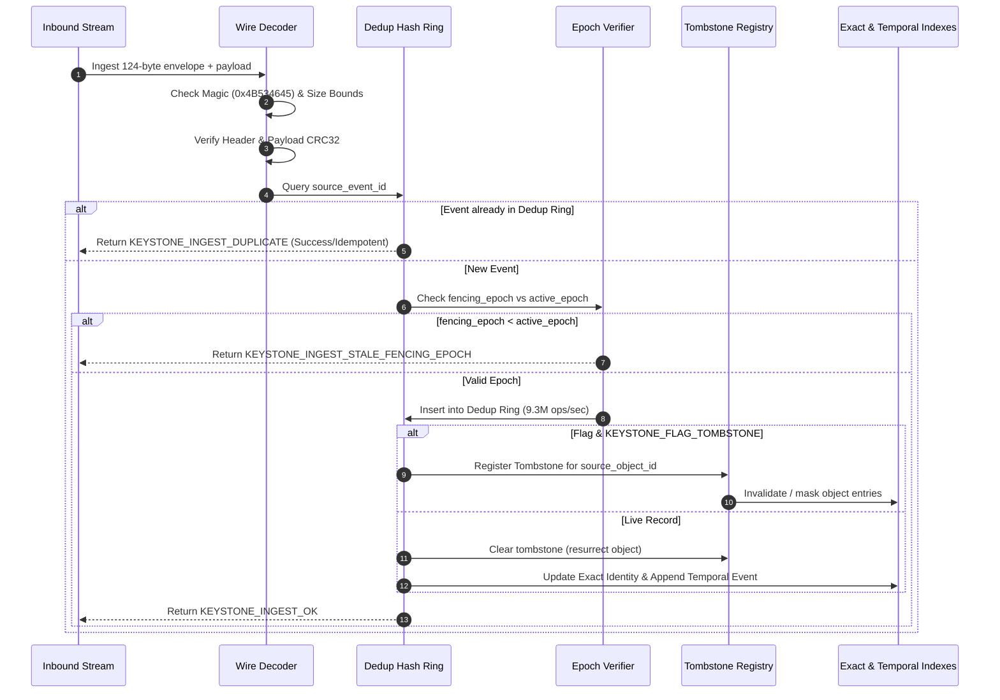

<!--
  SPDX-License-Identifier: LicenseRef-SRSL-1.1
  Copyright (C) 2026 SWORDIntel. All rights reserved.
-->

# Federation Ingest Architecture

This document specifies the wire envelope, serialization mechanics, deduplication, tombstone handling, and atomic persistence of the KEYSTONE Federation Ingest subsystem.

Governed by [`CITADEL/docs/architecture/KEYSTONE_FEDERATION_INTELLIGENCE_UPGRADE_BRIEF.md`](../../../CITADEL/docs/architecture/KEYSTONE_FEDERATION_INTELLIGENCE_UPGRADE_BRIEF.md), KEYSTONE provides high-speed event ingestion, exact identity indexing, and monotonic temporal ordering for CITADEL and QIHSE without acting as the authoritative system of record.

---

## 1. Architectural Boundaries

KEYSTONE adheres to strict isolation invariants:

```text
+-----------------------+     +-------------------------------+     +---------------------------+
| QIHSE / Consensus Bus | --> | KEYSTONE Federation Ingest    | --> | CITADEL Control Plane     |
| (Source of Truth)     |     | (Evidence & Indexing Layer)   |     | (Policy & Action Executor)|
+-----------------------+     +-------------------------------+     +---------------------------+
  - Lease management            - Wire envelope validation            - Placement execution
  - Raft consensus              - 9.3M events/sec dedup ring          - VM lifecycle & fencing
  - Fencing epoch authority     - Exact & temporal indexing           - Non-authoritative advisory
  - Immutable event log         - Atomic checkpointing                - Never delegates truth
```

- **QIHSE** is the authoritative system of record. It owns leases, fencing epochs, and state transitions.
- **KEYSTONE** ingests events, extracts features, indexes identities, and provides sub-millisecond retrieval. It does not own or modify cluster state.
- **CITADEL** consumes KEYSTONE's explainable recommendations and telemetry summaries, but verifies hard fencing epochs and executes hypervisor actions independently.

---

## 2. Canonical Federation Wire Envelope

All events arriving from QIHSE or federated peer indexers are wrapped in a 124-byte packed binary wire header followed by payload bytes. The format is implemented in [`src/federation/keystone_federation_ingest.c`](../../src/federation/keystone_federation_ingest.c) and exposed through [`include/keystone_federation.h`](../../include/keystone_federation.h).

The packed header stores these fields in order: magic, version, flags,
tenant ID, classification, object type, SCI compartments, source generation,
fencing epoch, HLC physical/logical/node components, three 16-byte source IDs,
payload length, header CRC32, and payload CRC32. Payload bytes follow the header.

The CRC table is initialized once with C11 atomics. Concurrent serializers and
deserializers see it only after publication. Both checksums use IEEE CRC32;
the header checksum covers the first 116 header bytes and the payload checksum
covers the payload bytes. This is distinct from SSE4.2 CRC32C.


### Wire Fields Specification

| Field | Type | Description |
|---|---|---|
| `magic` | `uint32_t` | Constant `0x4B534645` (`'KSFE'`). |
| `version` | `uint32_t` | Wire format version (currently `1`). |
| `flags` | `uint32_t` | Ingest flags: `TOMBSTONE`, `SNAPSHOT`, `EVENT`, `TELEMETRY`, `AUDIT`, `SECURITY_SENSITIVE`. |
| `tenant_id` | `uint32_t` | Tenant boundary. |
| `classification` | `uint32_t` | Security classification. |
| `object_type` | `uint32_t` | Domain entity type. |
| `sci` | `uint32_t` | SCI compartments. |
| `source_generation` | `uint64_t` | Source index generation. |
| `fencing_epoch` | `uint64_t` | Source fencing epoch. |
| `hlc_physical_ms`, `hlc_logical`, `hlc_node_id` | `uint64_t`, `uint32_t`, `uint32_t` | Hybrid logical clock components. |
| `source_object_id`, `source_event_id`, `source_node_id` | 16 bytes each | Source identifiers. |
| `payload_len` | `uint64_t` | Payload size, capped by `KEYSTONE_MAX_PAYLOAD_LEN`. |
| `header_crc32` | `uint32_t` | IEEE CRC32 of the first 116 header bytes. |
| `payload_crc32` | `uint32_t` | IEEE CRC32 of payload bytes; zero for empty payload. |

---

## 3. UUID & Monotonic Hybrid Logical Clock (HLC)

### 128-bit UUID Primitive
[`keystone_uuid_t`](../../include/keystone_federation.h) provides a 16-byte structure with:
- Standard 8-4-4-4-12 RFC 4122 string formatting and parsing (`keystone_uuid_to_string`, `keystone_uuid_from_string`).
- Fast branchless 128-bit equality comparison (`keystone_uuid_equal`).
- 64-bit Murmur/avalanche hash function (`keystone_uuid_hash64`) with uniform bit dispersion across hash buckets.

### Monotonic HLC Invariants
[`keystone_hlc_t`](../../include/keystone_federation.h) maintains causal order across federated nodes without requiring perfectly synchronized wall clocks:

```c
typedef struct {
    uint64_t physical_ms;   /* Wall-clock millisecond component */
    uint32_t logical;       /* Monotonic increment for concurrent ticks */
    uint32_t node_id;       /* Deterministic tie-breaker */
} keystone_hlc_t;
```

1. **Monotonicity**: If event $B$ causally follows event $A$, then $\text{HLC}(B) > \text{HLC}(A)$.
2. **Causal Update**: Upon receiving an envelope with $\text{HLC}_{msg}$, the local clock advances:
   $$\text{physical}_{now} = \max(\text{physical}_{local}, \text{physical}_{msg}, \text{wall\_time}())$$
   $$\text{logical}_{now} = \begin{cases} \text{logical}_{local} + 1 & \text{if } \text{physical}_{now} = \text{physical}_{local} = \text{physical}_{msg} \\ \text{logical}_{msg} + 1 & \text{if } \text{physical}_{now} = \text{physical}_{msg} > \text{physical}_{local} \\ 0 & \text{otherwise} \end{cases}$$
3. **Deterministic Comparison**: Comparison evaluates `physical_ms` first, then `logical`, and resolves ties with `node_id`.

---

## 4. Ingestion Lifecycle & Deduplication



### High-Throughput Deduplication Ring
Implemented in [`src/federation/keystone_federation_ingest.c`](../../src/federation/keystone_federation_ingest.c):
- Circular power-of-two slot table with open-addressing and 64-bit avalanche hashing.
- Guaranteed $O(1)$ query and insertion time.
- Measured performance: **9.3+ million events/second** (107 ns/event) under concurrent test loads.

---

## 5. Tombstone Mechanics & Fencing Protection

### Tombstone Registry
When a node or entity is decommissioned or terminated:
1. QIHSE emits an envelope with `KEYSTONE_FLAG_TOMBSTONE`.
2. The ingestion engine inserts the `source_object_id` into the `keystone_tombstone_registry_t`.
3. Subsequent exact identity searches check `keystone_federation_is_tombstoned()` and immediately mask the object as non-existent.
4. If a newer snapshot or creation event arrives with a higher generation/epoch, the tombstone is atomically cleared, supporting intentional resource resurrection.

### Fencing Epoch Protection
To eliminate split-brain write pollution from partitioned nodes:
- The engine maintains the highest known `active_fencing_epoch`.
- Any envelope bearing `fencing_epoch < engine->active_fencing_epoch` is rejected with `KEYSTONE_INGEST_STALE_FENCING_EPOCH`.
- When an envelope arrives with `fencing_epoch > engine->active_fencing_epoch`, the engine advances its active epoch and logs an epoch transition audit event.

---

## 6. Atomic Double-Buffered Checkpointing

Engine watermarks, active epochs, dedup state, and index checkpoints must survive daemon crashes and power loss:

```text
1. Allocate / Format In-Memory Checkpoint Frame
2. Compute CRC32 Checksum of Checkpoint Data
3. Write Frame to "<path>.tmp"
4. Invoke fsync(fd) to Flush Disk Caches
5. Atomic rename("<path>.tmp", "<path>")
```

- If a crash occurs during step 1–4, the primary checkpoint file remains unmodified and uncorrupted.
- On startup, `keystone_federation_restore_checkpoint()` reads the file, validates the CRC32 checksum, and verifies that the checkpoint generation is $\ge$ the local generation before applying state.

---

## 7. Status Codes & Error Handling

All ingestion operations return explicit codes defined in `keystone_ingest_status_t`:

| Status Code | Value | Meaning |
|---|---|---|
| `KEYSTONE_INGEST_OK` | `0` | Event ingested and indexed successfully. |
| `KEYSTONE_INGEST_DUPLICATE` | `1` | Duplicate event ID detected; skipped idempotently without error. |
| `KEYSTONE_INGEST_CORRUPT_HEADER` | `2` | Magic mismatch, invalid header size, or header CRC32 failure. |
| `KEYSTONE_INGEST_CORRUPT_PAYLOAD` | `3` | Payload CRC32 verification failed. |
| `KEYSTONE_INGEST_PAYLOAD_TOO_LARGE` | `4` | Payload exceeded the 64 MiB bounded allocation safety limit. |
| `KEYSTONE_INGEST_STALE_GENERATION` | `5` | Event generation is older than the currently published index generation. |
| `KEYSTONE_INGEST_STALE_FENCING_EPOCH` | `6` | Event fencing epoch is lower than the active cluster epoch. |
| `KEYSTONE_INGEST_BUFFER_TOO_SMALL` | `7` | Destination buffer insufficient for serialized envelope. |
| `KEYSTONE_INGEST_INVALID_ARG` | `8` | Null pointer or uninitialized structure argument. |
